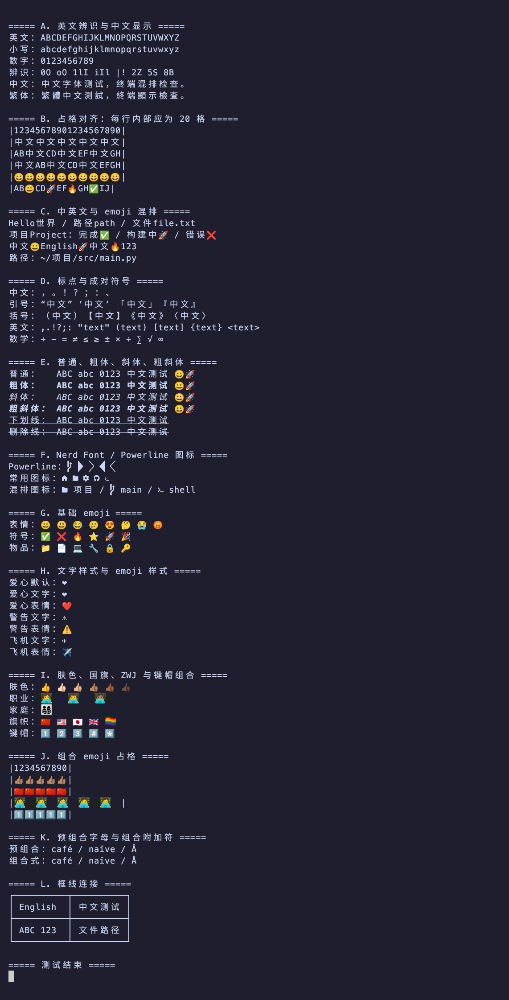

<h1 align="center">MesloLGM NF</h1>

<p align="center">
  <a href="README.md"></a>
  <a href="README.zh-CN.md"></a>
</p>

A rebuild of **Meslo LG M** (medium line height) on top of [Nerd Fonts](https://github.com/ryanoasis/nerd-fonts) **v3.5.1**, with icon sizing aligned to the legacy `MesloLGS NF`, plus an optional CJK-merged variant.

<p align="center">
  <br>
  <sub>MesloLGM NF SC — CJK and Latin alignment, emoji, italics, Nerd Font icons, box drawing</sub>
</p>

## Two builds

| Directory | Family name | Contents | Glyphs | Per file |
|---|---|---|---|---|
| `MesloLGM NF/` | `MesloLGM NF` | Latin + Nerd Font icons | ~13.6k | ~3 MB |
| `MesloLGM NF SC/` | `MesloLGM NF SC` | the above + CJK | ~35.8k | ~11 MB |

Each build ships Regular, Bold, Italic and Bold Italic. Pick the family name in your terminal or editor after installing; both builds can be installed side by side.

## Features

- **Legacy icon size.** The advance width stays exactly one cell (1233 / 2048); icons are drawn into a 1.2-cell box (ink width ≈1480), matching the 2.x-era `MesloLGS NF` (1478–1482).
- **Modern glyph set.** Includes Codicons, the new Material Design range (`F0001+`), Font Awesome 6, and more.
- **Medium line height.** Roughly 10% taller than the S variant.
- **Fixed-pitch flag.** `post.isFixedPitch` is set to `1`, so macOS classifies the family as monospaced; upstream Meslo leaves it at `0`, which hides the font from monospace-only pickers.
- **CJK (SC build only).** See below.

## Metrics

| Characters | Width |
|---|---|
| Latin / digits / symbols | 1233 units = 0.602 em (1 cell) |
| Han / fullwidth punctuation | 2466 units = 1.204 em (2 cells) |

CJK glyphs come from **Noto Sans Mono CJK SC** (a monospaced cut of Source Han Sans), scaled 1.0 and centered in a 2-cell box. Cap-height-to-em is nearly identical to Meslo (0.733 vs 0.729), so mixed CJK/Latin text lines up well.

- Charset: **GBK** (21,791 characters, including the traditional forms it carries), plus CJK punctuation, kana, bopomofo and fullwidth forms.
- Only codepoints missing from Meslo are added; existing glyphs and Nerd Font icons are never overwritten.
- Italic: the CJK source has no italic, so CJK glyphs are slanted by Meslo's italic angle (11°).

## Layout

```
MesloLGM NF/                    build output, Latin + icons
MesloLGM NF SC/                 build output, with CJK
patch/legacy-icon-size.patch    patch against upstream font-patcher (patch -p1)
build.sh                        one-shot build
rename_fonts.py                 rename pass (called by build.sh)
add_cjk.py                      CJK merge (called by build.sh, usable standalone)
licenses/                       Meslo (Apache 2.0) and Noto CJK (OFL 1.1) license texts
```

## Building it yourself

```bash
sudo apt install git patch curl fontforge python3-fontforge
pip install fonttools

./build.sh                       # M variant: ./dist (no CJK) and ./dist/sc (CJK)
./build.sh S ~/out               # S variant, custom output directory
CJK=0 ./build.sh                 # skip the CJK build
CJK_CHARSET=gb2312 ./build.sh    # common simplified set, ~5.5 MB per SC file
FAMILY="My Meslo NF" ./build.sh  # custom family name (CJK build becomes "<family> SC")
```

The script pins Nerd Fonts `v3.5.1` and Noto CJK `Sans2.004`, verifies the Noto files against their sha256, and restores `font-patcher` before patching every run, so it is idempotent.

Merging CJK into any monospaced font on its own:

```bash
python3 add_cjk.py MesloLGM_NF_Regular.ttf <cjk-font.otf/.ttf> out.ttf --charset gbk [--scale 1.0 | --fit]
```

## What the patch changes

| Change | Effect |
|---|---|
| Default icon set and Font Awesome: `stretch: 'pa1!'` + `overlap: 0.2` | Icons are scaled into a 1.2-cell-wide box while the advance remains one cell |
| `WEATH_SCALE_LIST = None` | Weather icons are no longer scaled as a group, keeping their sizes uniform |
| Powerline `E0A0–E0A3`: `'^pa1!'` | Branch symbols fill the full line height, restoring the legacy size |

To keep icons strictly inside one cell, drop `'overlap': 0.2` from the patch, or use the official `Mono` variant.

## Known differences

- Icon shapes come from newer icon libraries; widths match the legacy build, aspect ratios may not.
- Powerline Extra (`E0B4–E0D7`) follows the Nerd Fonts 3.x rules and is not the same artwork as in 2.x.
- Legacy Material Design codepoints (`F534–FD46`) moved to `F0001+` and are not restored.
- Icons are slightly wider than the cell, so leave one space after an icon (Powerlevel10k does this by default).
- Upstream Meslo Italic itself lacks `✔` `✘` (U+2714 / U+2718); unrelated to this project.
- CJK glyphs carry no TrueType hinting, so small sizes on Windows may be less crisp than on macOS or Linux.

## License

- Meslo itself: Apache License 2.0.
- Merged CJK glyphs: Noto Sans Mono CJK SC, SIL Open Font License 1.1 (copyright and license fields inside the font files cite the source).
- Icons come from their respective open-source icon sets; see the [Nerd Fonts glyphs README](https://github.com/ryanoasis/nerd-fonts/blob/-/src/glyphs/README.md).

I am not a lawyer; check the license requirements yourself before redistributing fonts that contain OFL glyphs.
