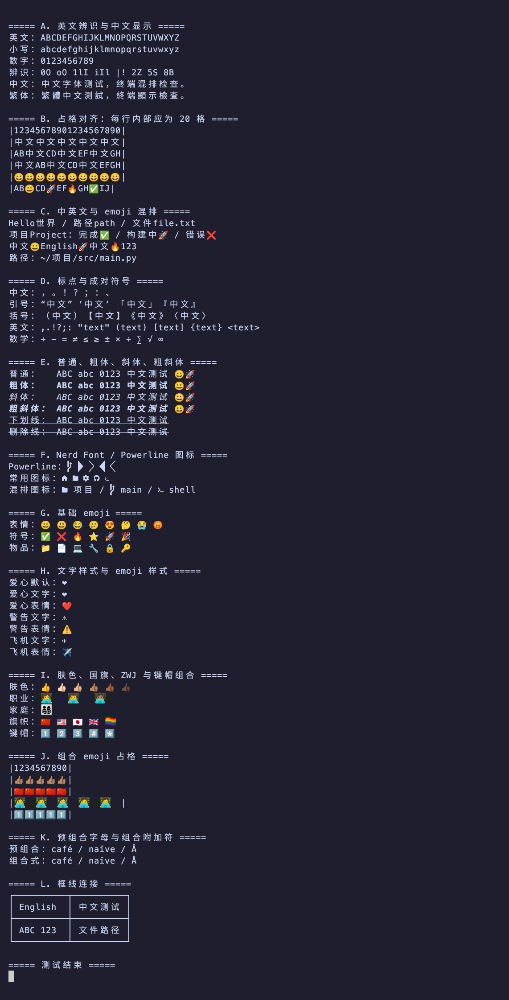

<h1 align="center">MesloLGM NF</h1>

<p align="center">
  <a href="README.md"></a>
  <a href="README.zh-CN.md"></a>
</p>

基于 [Nerd Fonts](https://github.com/ryanoasis/nerd-fonts) **v3.5.1** 重新生成的 **Meslo LG M**（中等行高）：图标尺寸对齐旧版 `MesloLGS NF`，并提供合并中文的版本。

<p align="center">
  <br>
  <sub>MesloLGM NF SC — 中英文对齐、emoji、斜体、Nerd Font 图标、框线连接</sub>
</p>

## 两套字体

| 目录 | 家族名 | 内容 | 字形数 | 单文件大小 |
|---|---|---|---|---|
| `MesloLGM NF/` | `MesloLGM NF` | 仅拉丁字符和 Nerd Font 图标 | 约 1.36 万 | 约 3 MB |
| `MesloLGM NF SC/` | `MesloLGM NF SC` | 在上面基础上合并中文 | 约 3.58 万 | 约 11 MB |

每套都有 Regular、Bold、Italic、Bold Italic 四个文件。安装后在终端或编辑器里选择对应的家族名即可，两套可同时安装。

## 特点

- **旧版图标尺寸**：字符宽度固定为 1 格（1233 / 2048），图标画在 1.2 格宽的框内（墨迹宽度约 1480），与 2.x 时代的 `MesloLGS NF`（1478–1482）一致。
- **新版图标集**：含 Codicons、新版 Material Design（`F0001+`）、Font Awesome 6 等。
- **中等行高**：比 S 版大约 10%。
- **等宽标记**：`post.isFixedPitch` 置为 `1`，系统会把家族识别为等宽字体；上游 Meslo 该字段是 `0`，会导致「只列等宽字体」的选择器看不到它。
- **中文（SC 版）**：见下。

## 宽度

| 字符 | 宽度 |
|---|---|
| 英文 / 数字 / 符号 | 1233 单位 = 0.602 em（1 格） |
| 汉字 / 全角标点 | 2466 单位 = 1.204 em（2 格） |

中文来自 **Noto Sans Mono CJK SC**（思源黑体的等宽版本），字形缩放 1.0，居中放入 2 格；大写字母高度占 em 的比例与 Meslo 几乎一致（0.733 / 0.729），中英文混排比较协调。

- 字符集：**GBK**（21,791 个字符，含 GBK 收录的繁体字），另含 CJK 标点、日文假名、注音、全角形式。
- 只添加 Meslo 里没有的码位，不覆盖原有字形和 Nerd Font 图标。
- 斜体：中文字体本身没有斜体，按 Meslo 的斜体角度（11°）对汉字做倾斜。

## 目录

```
MesloLGM NF/                   成品，拉丁字符 + 图标
MesloLGM NF SC/                成品，含中文
patch/legacy-icon-size.patch   对官方 font-patcher 的补丁（patch -p1）
build.sh                       一键构建
rename_fonts.py                构建后改名（由 build.sh 调用）
add_cjk.py                     合并中文（由 build.sh 调用，也可单独使用）
licenses/                      Meslo（Apache 2.0）与 Noto CJK（OFL 1.1）许可文本
```

## 自己构建

```bash
sudo apt install git patch curl fontforge python3-fontforge
pip install fonttools

./build.sh                       # M 版，输出到 ./dist（无中文）和 ./dist/sc（含中文）
./build.sh S ~/out               # S 版，指定输出目录
CJK=0 ./build.sh                 # 只生成无中文版
CJK_CHARSET=gb2312 ./build.sh    # 常用简体，SC 版约 5.5 MB
FAMILY="My Meslo NF" ./build.sh  # 自定义家族名（中文版为 "<家族名> SC"）
```

脚本固定克隆 Nerd Fonts `v3.5.1` 和 Noto CJK `Sans2.004`，并校验 Noto 文件的 sha256；每次运行都会先还原 `font-patcher`，可重复执行。

单独合并任意等宽中文字体：

```bash
python3 add_cjk.py MesloLGM_NF_Regular.ttf <中文字体.otf/.ttf> out.ttf --charset gbk [--scale 1.0 | --fit]
```

## 补丁内容

| 修改 | 作用 |
|---|---|
| 默认图标集与 Font Awesome：`stretch: 'pa1!'` + `overlap: 0.2` | 图标画进 1.2 格宽的框内，字符宽度仍是 1 格 |
| `WEATH_SCALE_LIST = None` | Weather 取消成组缩放，保证尺寸统一 |
| Powerline `E0A0–E0A3`：`'^pa1!'` | 分支符号放大到整行高度，恢复旧版大小 |

想让图标严格限制在 1 格内：把补丁里的 `'overlap': 0.2` 去掉，或直接用官方 `Mono` 变体。

## 已知差异

- 图标形状来自较新的图标库，宽度与旧版一致，长宽比可能不同。
- Powerline Extra（`E0B4–E0D7`）遵循 Nerd Fonts 3.x 新规则，与旧版不是同一组图形。
- 旧版 `F534–FD46` 的 Material Design 码位已迁移到 `F0001+`，不会恢复。
- 图标比单元格略宽，图标后面建议留一个空格（Powerlevel10k 默认如此）。
- 上游 Meslo 的 Italic 本身没有 `✔` `✘`（U+2714 / U+2718），与本项目无关。
- 中文字形没有 TrueType 提示信息，Windows 上小字号显示可能不如 macOS / Linux 清晰。

## 许可

- Meslo 字体本体：Apache License 2.0。
- 合并的中文字形：Noto Sans Mono CJK SC，SIL Open Font License 1.1（字体文件的版权与许可字段已写入来源说明）。
- 图标来自各自的开源图标库，详见 [Nerd Fonts glyphs README](https://github.com/ryanoasis/nerd-fonts/blob/-/src/glyphs/README.md)。

我不是律师；再分发含 OFL 字形的字体前，请自行确认许可要求。
